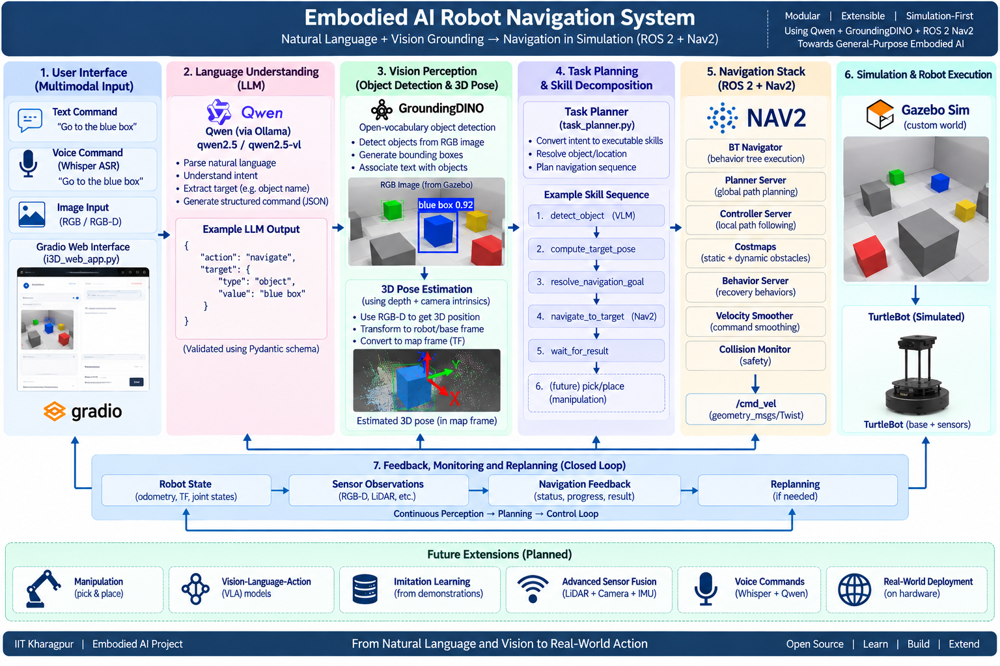
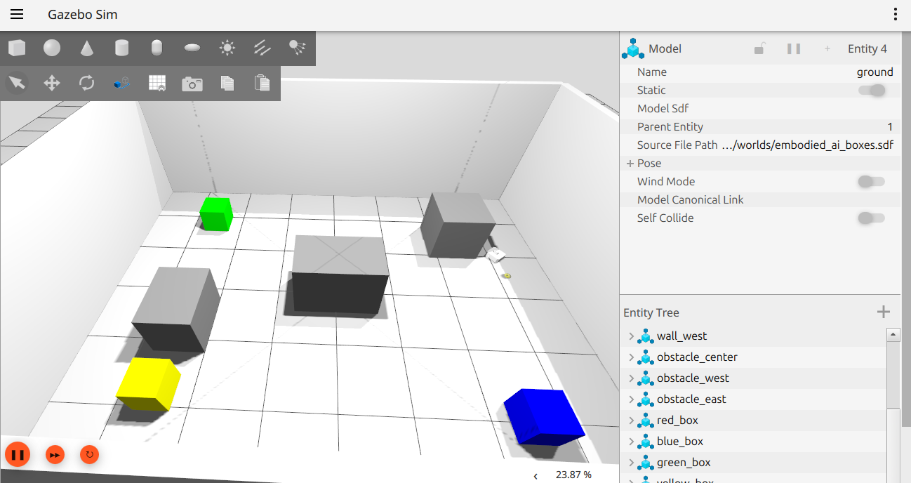
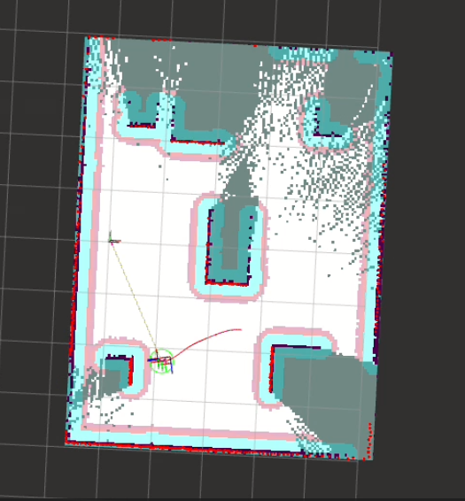
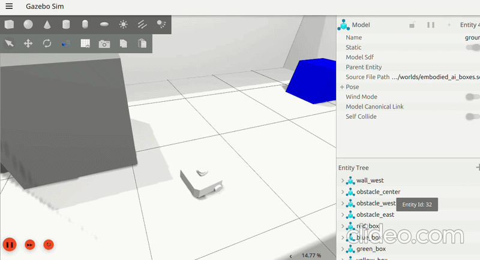
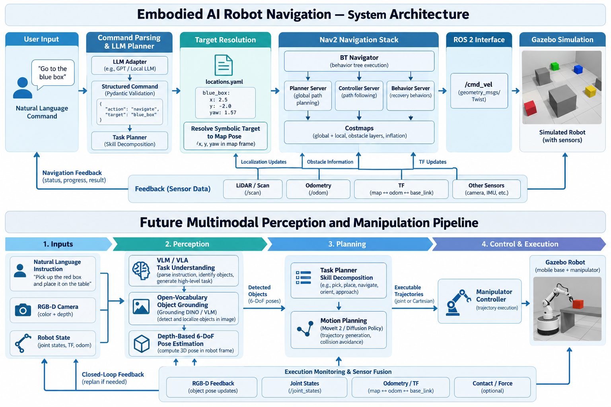

# Embodied AI Robot Navigation

A modular **Embodied AI robot navigation system** that converts natural-language instructions into validated robot commands and executes them through a structured task-planning and ROS 2 navigation stack.

The architecture is designed as a foundation for **language-grounded robotics, multimodal perception, sensor fusion, VLM/VLA-based interaction, and future imitation learning**.

---

## Overview

The system separates high-level intelligence from deterministic robot execution.

A natural-language instruction is processed by an LLM and converted into a constrained structured command. The command is then validated, decomposed into executable skills, resolved against the robot's environment configuration, and executed through ROS 2 and Nav2.

```text
User Instruction
       │
       ▼
Gradio Interface
(text now; voice input planned)
       │
       ▼
LLM / VLM Command Understanding
       │
       ▼
Validated Structured Command
(Pydantic schema)
       │
       ▼
Task Planner / Skill Decomposition
       │
       ├──────────────────────────────────────────────┐
       │                                              │
       ▼                                              ▼
Named-Location Resolution                    VLM-Based Object Grounding
(locations.yaml)                              (planned multimodal path)
       │                                              │
       │                                      Object Detection / BBox
       │                                              │
       │                                      RGB-D Depth Association
       │                                              │
       │                                      3D Object Pose Estimation
       │                                              │
       └──────────────────────┬───────────────────────┘
                              ▼
                   Target Pose in Robot / Map Frame
                              │
                              ▼
                    ROS 2 Navigation Executor
                              │
                              ▼
                             Nav2
                              │
                              ▼
                         /cmd_vel
                              │
                              ▼
                       Gazebo Robot
                              ▲
                              │
            LiDAR / RGB-D / Odometry / TF Feedback
```

The LLM does not directly generate ROS commands, shell commands, Python code, or physical robot coordinates.

The VLM-grounded navigation path is designed as a modular extension: the VLM identifies the requested object, an open-vocabulary grounding module returns a bounding box, RGB-D or depth processing estimates the object's 3D position, and a coordinate-transform layer converts that position into a navigation target for ROS 2/Nav2. The current blue-box demonstration should be interpreted according to the active implementation: deterministic SDF/configuration-based target resolution is implemented, while end-to-end VLM detection and depth-based pose estimation remain planned integration stages unless explicitly enabled in the codebase.




## Visual Documentation

Store the four PNG images and the navigation GIF under `docs/images/`.

| Asset | Path | Purpose |
|---|---|---|
| System architecture | `docs/images/system-architecture.png` | Integrated architecture showing LLM/VLM understanding, object grounding, RGB-D pose estimation, target resolution, ROS 2/Nav2, and feedback |
| Gazebo custom world | `docs/images/gazebo-customworld.png` | Custom Gazebo environment containing the TurtleBot3 robot, obstacles, and colored boxes |
| RViz navigation | `docs/images/rviz-navigation.png` | RViz map, robot pose, sensor data, obstacles, and navigation state |
| Future perception pipeline | `docs/images/future-perception-pipeline.png` | Planned VLM/VLA, bounding-box grounding, 6-DoF pose estimation, planning, manipulation, and closed-loop feedback |
| Blue-box navigation GIF | `docs/images/blue-box-navigation.gif` | Demonstration of the TurtleBot moving toward the blue box |

Create the directory with:

```bash
mkdir -p docs/images
```

Copy or rename the assets to match the paths above. The GIF should be a real execution demonstration. The architecture and future-pipeline PNGs describe the intended system and should not be interpreted as proof that every planned component is already implemented.

---

## Current Status

### V1 — Language-Grounded Navigation Foundation

The current implementation provides:

- Natural-language to structured robot command conversion
- Strict command validation using Pydantic
- Deterministic task and skill decomposition
- Named-location target resolution
- Execution context for resolved targets
- ROS 2 Jazzy integration
- Nav2 `NavigateToPose` action execution
- Navigation feedback handling
- Navigation result and error handling
- Goal cancellation support
- Structured execution results
- Mock execution for development and testing
- End-to-end LLM → command → planner → ROS 2 → Nav2 pipeline

### Planned Extensions

The architecture is intended to evolve toward:

- Vision-language models (VLMs)
- Open-vocabulary object grounding
- RGB/RGB-D perception
- LiDAR and camera sensor fusion
- 3D object localization
- Language-grounded navigation to dynamic objects
- Expanded skill libraries
- Manipulation capabilities
- Vision-language-action (VLA) models
- Imitation learning
- Hardware deployment

These components are future development targets and are not claimed as implemented unless present in the repository.


### Current Simulation Evidence

The custom Gazebo world contains multiple colored boxes and a TurtleBot3-based mobile robot.

Tested components include:

- ROS 2 Jazzy and Gazebo simulation
- RViz visualization
- TF and odometry streams
- LiDAR scan publication
- Nav2 global planning
- `NavigateToPose` goal submission
- Manual velocity command testing
- Natural-language named-location resolution

The box-to-goal test currently reaches Nav2 execution, but the final approach can stall while rotational commands continue. This remains an active debugging item.







---

## Architecture

### 1. LLM / Language Interface

The LLM is responsible for interpreting the user's natural-language instruction.

Example:

```
Go to Executor Test
```

is converted into:

```json
{
  "action": "navigate",
  "target": {
    "type": "named_location",
    "value": "Executor Test"
  }
}
```

The LLM does not determine the physical coordinates of the destination.

Instead, symbolic targets are resolved separately by the robot-side configuration.

### 2. Command Schema

`command_schema.py`

Defines the allowed robot command vocabulary using Pydantic models.

Currently supported commands include:

- `navigate`
- `move`
- `rotate`
- `stop`
- `wait`
- `sequence`

Example:

```json
{
  "action": "navigate",
  "target": {
    "type": "named_location",
    "value": "Station 1"
  }
}
```

The schema uses strict validation to reject unsupported commands and unexpected fields.

This provides a deterministic boundary between probabilistic language-model output and robot execution.

### 3. Command Pipeline

`command_pipeline.py`

The command pipeline connects validation, planning, and execution.

```text
Raw Command
    │
    ▼
Schema Validation
    │
    ▼
Task Planning
    │
    ▼
Skill Execution
    │
    ▼
Execution Result
```

The pipeline does not allow the LLM to bypass validation or directly invoke the robot.

### 4. Task Planner

`task_planner.py`

The task planner converts validated high-level commands into executable skills.

For example:

```
navigate("Station 1")
```

becomes:

```text
resolve_target
       ↓
navigate_to_target
       ↓
wait_for_navigation_result
```

A sequence command can be decomposed into multiple ordered skills.

Example:

```json
{
  "action": "sequence",
  "commands": [
    {
      "action": "navigate",
      "target": {
        "type": "named_location",
        "value": "Station 1"
      }
    },
    {
      "action": "wait",
      "duration": 5,
      "unit": "s"
    },
    {
      "action": "navigate",
      "target": {
        "type": "named_location",
        "value": "Base Station"
      }
    }
  ]
}
```

The planner is intentionally separated from the underlying ROS 2 implementation.

This allows high-level task decomposition to remain independent of the robot execution backend.

### 5. Target Resolution

`target_resolver.py`

Named destinations are represented symbolically by the language layer.

Physical poses are resolved separately using:

`config/locations.yaml`

Example:

```yaml
frame_id: map

locations:
  Station 1:
    x: 1.0
    y: 2.0
    yaw: 0.0
```

The language model produces:

```
Station 1
```

rather than:

```
x = 1.0
y = 2.0
yaw = 0.0
```

This separation prevents the LLM from inventing physical robot coordinates.

The target resolver converts a symbolic target into a structured 2D pose containing:

- `frame_id`
- `x`
- `y`
- `yaw`

### 6. Execution Context

`execution_context.py`

The execution context stores information produced during execution and makes it available to subsequent skills.

For example:

```text
resolve_target
       │
       ▼
Resolved Target Pose
       │
       ▼
ExecutionContext
       │
       ▼
navigate_to_target
```

The execution context is also designed to support future perception-grounded targets.

A future object-navigation pipeline could conceptually become:

```text
"Go to the red box"
        │
        ▼
   Visual Grounding
        │
        ▼
Object / Target Representation
        │
        ▼
 Execution Context
        │
        ▼
 Navigation Skill
```

This allows perception results to become inputs to downstream skills without tightly coupling the perception system to the task planner.

### Box-to-Nav2 Goal Test

The current validation script reads a selected box pose from the simulation world, computes a candidate standoff pose, and submits it to Nav2.

```bash
python3 box_to_nav2_goal_test.py \
  --world-file "simulation/worlds/embodied_ai_boxes.sdf" \
  --box-name red_box
```


**Note:** This is currently a deterministic validation tool. It reads the box pose from the SDF file and does not yet perform VLM-based visual grounding.

### 7. ROS 2 Executor

`ros2_executor.py`

The ROS 2 executor connects the abstract skill layer to the ROS 2 navigation stack.

Current navigation execution uses:

```text
ROS 2 Jazzy
     │
     ▼
    Nav2
     │
     ▼
NavigateToPose
```

The executor is responsible for:

- Connecting to the Nav2 action server
- Constructing navigation goals
- Sending goals asynchronously
- Processing navigation feedback
- Waiting for navigation results
- Detecting navigation failures
- Handling goal cancellation
- Returning structured execution results

The executor is deliberately separated from the LLM and task-planning layers.

### 8. Structured Execution Results

`execution_result.py`

Robot execution returns a structured result rather than relying only on console output.

A result contains information such as:

- `success`
- `message`
- `error_code`
- `error_message`
- `metadata`

This provides a foundation for higher-level failure handling, logging, monitoring, and future task replanning.

---

## Supported Command Interface

### Navigate

```json
{
  "action": "navigate",
  "target": {
    "type": "named_location",
    "value": "Station 1"
  }
}
```

### Move

```json
{
  "action": "move",
  "direction": "forward",
  "distance": 1.0,
  "unit": "m"
}
```

### Rotate

```json
{
  "action": "rotate",
  "direction": "left",
  "angle": 90.0,
  "unit": "deg"
}
```

### Stop

```json
{
  "action": "stop"
}
```

### Wait

```json
{
  "action": "wait",
  "duration": 5,
  "unit": "s"
}
```

### Sequence

```json
{
  "action": "sequence",
  "commands": [
    {
      "action": "navigate",
      "target": {
        "type": "named_location",
        "value": "Station 1"
      }
    },
    {
      "action": "wait",
      "duration": 5,
      "unit": "s"
    },
    {
      "action": "navigate",
      "target": {
        "type": "named_location",
        "value": "Base Station"
      }
    }
  ]
}
```

---

## Project Structure

```text
embodied-ai-robot-navigation/
│
├── command_schema.py
├── command_pipeline.py
├── llm_adapter.py
│
├── task_planner.py
├── execution_context.py
├── execution_result.py
│
├── target_resolver.py
├── ros2_executor.py
├── mock_executor.py
│
├── config/
│   └── locations.yaml
│
├── test_command_pipeline.py
├── test_execution_result.py
├── test_executor_client.py
├── test_action_client.py
├── test_llm_pipeline.py
│
├── I3D_web_app.py
├── LLM_backend.py
├── robot_control.py
│
├── LICENSE
├── README.md
└── .gitignore
```

Some legacy files from the original project are retained while the architecture is being migrated toward the new modular ROS 2 design.

---

## Requirements

### Software

The current development environment uses:

- Ubuntu / Linux
- Python 3.12
- ROS 2 Jazzy
- Nav2
- Gazebo
- Pydantic
- PyYAML
- NumPy
- Ollama

The project uses a Python virtual environment compatible with the system ROS 2 Python installation.

---

## Environment Setup

### 1. Source ROS 2

```bash
source /opt/ros/jazzy/setup.bash
```

### 2. Activate the project environment

```bash
source .venv/bin/activate
```

### 3. Verify ROS 2 Python integration

```bash
python -c "import rclpy; from nav2_msgs.action import NavigateToPose; print('ROS imports OK')"
```

Expected output:

```
ROS imports OK
```

### 4. Install Python dependencies

```bash
python -m pip install pydantic pyyaml numpy ollama
```

---

## Running the Navigation Simulation

The current development target is a ROS 2 Jazzy + Nav2 simulation environment.

Launch the TurtleBot3/Nav2 simulation:

```bash
source /opt/ros/jazzy/setup.bash

ros2 launch nav2_bringup tb3_simulation_launch.py headless:=False
```

Once Nav2 is running, verify the navigation action:

```bash
ros2 action info /navigate_to_pose
```

The navigation action server should be provided by:

```
/bt_navigator
```

---

## Testing

The repository contains multiple levels of testing.

### Execution Result Tests

```bash
python test_execution_result.py
```

### Command Pipeline

```bash
python test_command_pipeline.py
```

### LLM Pipeline

```bash
python test_llm_pipeline.py
```

The LLM pipeline follows:

```text
Natural Language
       ↓
     Ollama
       ↓
      JSON
       ↓
Pydantic Validation
       ↓
Command Pipeline
       ↓
   Task Planner
       ↓
  ROS 2 Executor
       ↓
      Nav2
```

---

## Gradio and Voice-Command Interface

The Gradio interface is the planned human-facing entry point for the system.

### Current direction

- Text commands are supported as the initial interaction mode.
- Voice commands will be added through speech-to-text, for example Whisper.
- The interface should display the interpreted command, detected target, confidence, bounding box, estimated pose, navigation state, and final result.
- The interface should not bypass command validation or directly publish unrestricted velocity commands.
- Future multimodal inputs may include an RGB/RGB-D frame, a spoken command, and robot-state feedback.

```text
Text / Voice Input
        │
        ▼
Speech-to-Text (voice mode)
        │
        ▼
LLM / VLM Command Interpretation
        │
        ▼
Validated Command + Target Reference
        │
        ▼
Perception / Navigation / Manipulation
        │
        ▼
Gradio Status, Visualization, and Result
```

Voice interaction and VLM-based perception are roadmap items unless their corresponding nodes and integrations are present in the repository.

---

## LLM Backend

The current LLM adapter supports an Ollama backend.

Example configuration:

```python
backend = OllamaLLMBackend(
    model="qwen3:4b",
    temperature=0.0,
)
```

The LLM is constrained to produce the project's robot-command schema.

It does not receive direct access to ROS execution.

This allows the language model backend to be replaced independently from the robot execution layer.

---

## Design Principles

### 1. LLMs interpret; deterministic software executes

The LLM should interpret language and produce a structured command.

It should not directly control actuators or issue arbitrary ROS commands.

```text
LLM
 ↓
Structured Command
 ↓
Validation
 ↓
Planning
 ↓
Execution
```

### 2. Symbolic targets instead of LLM-generated coordinates

The language model produces:

```
Station 1
```

rather than:

```
x = 3.42
y = -1.27
```

Physical poses are resolved by the robot-side configuration or, in future versions, by perception and localization systems.

### 3. Modular perception

The architecture is intended to support interchangeable perception modules.

Future perception sources may include:

- RGB Camera
- RGB-D Camera
- LiDAR
- Depth
- VLM
- Object Detector
- Segmentation

These components can be integrated through standardized representations rather than tightly coupling navigation to a single detector.

### 4. Separation of planning and execution

The task planner determines:

```
WHAT needs to happen
```

while the ROS 2 executor determines:

```
HOW the robot executes it
```

This separation improves modularity, testing, extensibility, and hardware portability.

### 5. Simulation-first development

The system is being developed in simulation before deployment to physical robotic hardware.

This allows:

- Rapid iteration
- Deterministic testing
- Safer experimentation
- Reproducible navigation experiments
- Hardware-independent software development

---

## Roadmap

### V1 — Language-Grounded Navigation

- [x] Structured robot command schema
- [x] Pydantic validation
- [x] Task and skill decomposition
- [x] Named-location resolution
- [x] Execution context
- [x] Structured execution results
- [x] ROS 2 Jazzy executor
- [x] Nav2 integration
- [x] Mock executor
- [x] LLM adapter
- [x] End-to-end command pipeline

### V2 — Multimodal Grounding

This phase converts object references such as “blue box” into perception-derived targets. The expected sequence is object detection/grounding → bounding box → depth association → 3D position or 6-DoF pose → TF transformation → Nav2 goal generation.

### V2 — Multimodal Grounding

- [ ] RGB camera integration
- [ ] VLM-based object grounding
- [ ] Open-vocabulary object queries
- [ ] Standardized perception outputs
- [ ] Camera/LiDAR/depth fusion
- [ ] 3D target estimation
- [ ] TF-based target transformation
- [ ] Navigation to dynamically grounded targets

### V3 — Embodied Task Execution

- [ ] Expanded skill library
- [ ] Multi-step embodied tasks
- [ ] Object interaction
- [ ] Manipulation integration
- [ ] Robust failure recovery
- [ ] Runtime task replanning

### V4 — VLA / Learning-Based Control

- [ ] Vision-Language-Action models
- [ ] Demonstration collection
- [ ] Imitation learning
- [ ] Learned policies
- [ ] Simulation-to-real evaluation

---

## VLM-Grounded Object Navigation Architecture

The intended multimodal navigation flow extends the current named-location pipeline so that the robot can respond to commands such as:

> “Go to the blue box.”

The VLM/perception subsystem is responsible for understanding the object reference and grounding it in the camera image. The navigation subsystem remains responsible for transforming the grounded target into a safe, executable robot goal.

```text
Natural-Language Command
        │
        ▼
Gradio Interface
(text input; voice input planned)
        │
        ▼
LLM / VLM Instruction Understanding
        │
        ├── Intent: navigate
        └── Target: blue box
        │
        ▼
Open-Vocabulary Object Grounding
(Grounding DINO / VLM-compatible detector)
        │
        ▼
Bounding Box + Confidence + Class Label
        │
        ▼
RGB-D / Depth Association
        │
        ▼
3D Object Position / Pose Estimation
        │
        ▼
Coordinate Transformation
(camera frame → base_link → odom/map)
        │
        ▼
Navigation Goal Generation
(standoff distance, approach direction, yaw)
        │
        ▼
Task Planner
        │
        ▼
ROS 2 NavigateToPose Action
        │
        ▼
Nav2 Global Planner + Controller
        │
        ▼
Gazebo Mobile Robot
        │
        └──────── Sensor and action feedback ────────┐
                                                     ▼
                                      Re-detection / Replanning
                                      when target or scene changes
```

### Perception output contract

The perception layer should expose a detector-agnostic result so that Grounding DINO, a VLM, a segmentation model, or another detector can be exchanged without changing the navigation executor.

```python
{
    "label": "blue box",
    "confidence": 0.93,
    "bbox_xyxy": [x_min, y_min, x_max, y_max],
    "depth_m": 2.15,
    "position_camera": {
        "x": 0.42,
        "y": -0.18,
        "z": 2.15
    },
    "position_map": None,
    "timestamp": 0.0,
    "frame_id": "camera_depth_optical_frame"
}
```

The values above are illustrative schema fields, not measured output from the current simulation. The production implementation should validate confidence, depth availability, coordinate frames, timestamp freshness, and target reachability before sending a navigation goal.

### Current implementation versus target implementation

| Capability | Status |
|---|---|
| Natural-language command interface | Implemented foundation |
| Gradio interface | Present; planned for multimodal and voice upgrades |
| Text command parsing and validation | Implemented foundation |
| Named-location resolution through configuration | Implemented |
| ROS 2 Jazzy and Nav2 navigation | Implemented and tested |
| Gazebo colored-box environment | Implemented |
| Blue-box movement demonstration | Demonstrated in simulation GIF |
| VLM-based object detection | Planned integration |
| Bounding-box extraction | Planned integration |
| RGB-D depth association | Planned integration |
| 3D / 6-DoF object pose estimation | Planned integration |
| Navigation to dynamically grounded object pose | Planned integration |
| Voice commands in Gradio | Planned integration |
| VLA and imitation learning | Longer-term roadmap |

---

## Target System Architecture

The long-term architecture is divided into interface, intelligence, perception, planning, execution, and feedback layers.

```text
                         USER
                           │
                           ▼
             Gradio Interface
          text input + future voice
                           │
                           ▼
                  LLM / VLM Layer
           instruction and target intent
                           │
                           ▼
                 Command Validator
                 Pydantic schema
                           │
                           ▼
                   Task Planner
              skill decomposition
                           │
          ┌────────────────┴────────────────┐
          │                                 │
          ▼                                 ▼
   Navigation Skills                 Perception Skills
   named locations                   VLM / detector
   Nav2 goals                        bbox / segmentation
          │                          RGB-D / depth
          │                          3D pose estimation
          │                                 │
          │                                 ▼
          │                       Target pose + confidence
          │                                 │
          └────────────────┬────────────────┘
                           ▼
                   Execution Context
             frames, target, constraints
                           │
                           ▼
                    Skill Executor
                           │
             ┌─────────────┴─────────────┐
             ▼                           ▼
          Nav2                    Future Manipulation
       mobile base                grasp / place / move
             │                           │
             └─────────────┬─────────────┘
                           ▼
                    Gazebo Simulation
                           ▲
                           │
          RGB-D / LiDAR / odometry / TF
                           │
                           └── closed-loop feedback
```

The architecture intentionally keeps perception modular. A detector or VLM should publish a standardized object-grounding result, while navigation and manipulation components consume validated target poses rather than depending on one specific model implementation.

---

## Future Multimodal Navigation

The intended future perception pipeline is:

```text
Natural Language
       │
       ▼
   VLM / LLM
       │
       ▼
Object / Scene Query
       │
       ▼
Visual Grounding
       │
       ▼
Camera / LiDAR / Depth
       │
       ▼
Sensor Fusion
       │
       ▼
3D Target Position
       │
       ▼
TF Transformation
       │
       ▼
Grounded Navigation Target
       │
       ▼
Task Planner
       │
       ▼
ROS 2 / Nav2
```

The perception layer is intended to remain detector-agnostic so that different object detection, segmentation, VLM, depth, or LiDAR systems can be integrated without redesigning the navigation architecture.



---


## Documentation Assets

Recommended repository layout:

```text
docs/
└── images/
    ├── system-architecture.png
    ├── gazebo-customworld.png
    ├── rviz-navigation.png
    ├── future-perception-pipeline.png
    └── blue-box-navigation.gif
```

Asset guidance:

- `system-architecture.png`: integrated architecture, including the VLM grounding branch.
- `gazebo-customworld.png`: actual custom Gazebo world screenshot.
- `rviz-navigation.png`: actual RViz screenshot.
- `future-perception-pipeline.png`: planned multimodal perception and manipulation architecture.
- `blue-box-navigation.gif`: actual TurtleBot movement demonstration toward the blue box.

Do not commit API keys, private machine paths, raw logs containing sensitive information, or credentials in documentation assets.

---

## Development Philosophy

This project is being developed as a modular robotics software stack with a focus on:

- Embodied AI
- Language grounding
- Multimodal perception
- Sensor fusion
- Task and skill planning
- Deterministic robot execution
- ROS 2 integration
- Simulation-first development
- Hardware abstraction
- Testability
- Extensible system architecture
- Future VLM/VLA integration
- Future imitation learning

The long-term objective is to develop a robot system capable of understanding natural-language goals, grounding those goals in its physical environment, planning appropriate skills, and executing them through a robust robotics stack.

---

## Attribution

This repository builds upon an earlier LLM-controlled robot navigation project.

The original work is attributed to:

> Mukund Mitra, Yashaswi Sinha, Arushi Khokhar, Sairam Jinkala, and Pradipta Biswas.
> "LMD-FISH: Language Model Driven - Framework for Intelligent Scheduling of Heterogenous Systems."
> Companion Proceedings of the 30th International Conference on Intelligent User Interfaces (IUI '25 Companion), 2025.

The original project served as the starting point for this work. This repository extends that starting point toward a modular Embodied AI and ROS 2 navigation architecture.

Please see `LICENSE` for licensing information.

---

## Author

**Gaurav Ramteke**

GitHub: [https://github.com/GauravR2012](https://github.com/GauravR2012)

---

## License

See `LICENSE`.